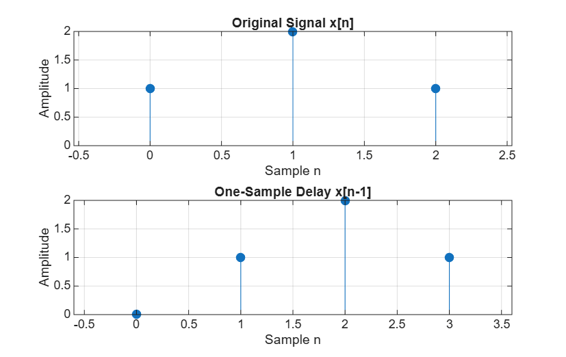
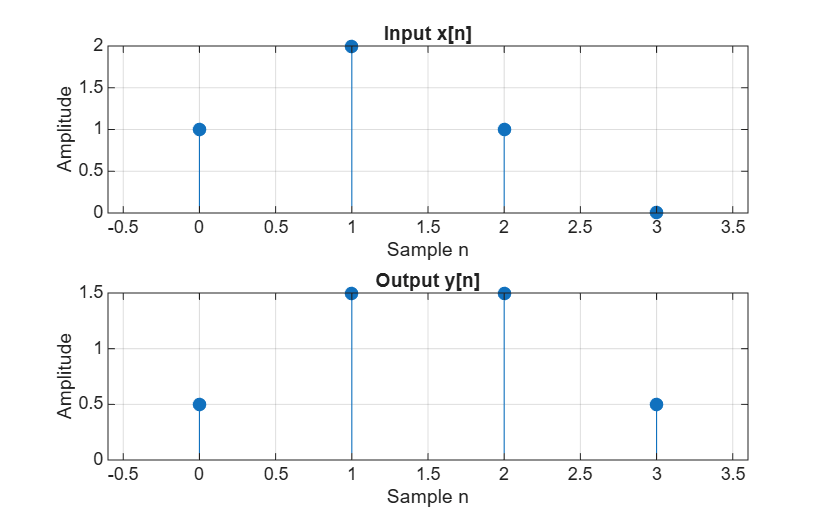
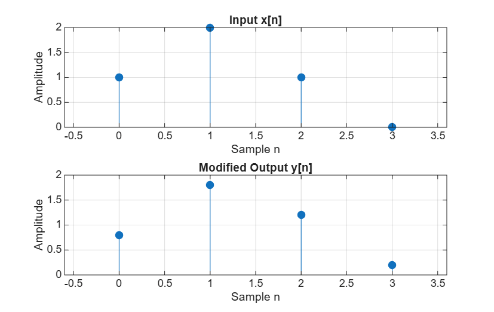

# Z-Transform MATLAB Assignment

## Objective

The objective of this assignment is to understand how discrete-time signals, one-sample delays, and FIR filters are represented using the Z-transform.

## Part 1 – A Signal and Its Z-Transform

### Question 1: Identify the sample represented by each term in X(z).

Given:

`X(z) = 1 + 2z⁻¹ + z⁻²`

- `1` represents x[0] = 1.
- `2z⁻¹` represents x[1] = 2.
- `z⁻²` represents x[2] = 1.

Each term represents a sample, and the exponent shows its position in the signal.

### Question 2: Write the Z-transform of the delayed signal.

The original signal is `[1, 2, 1]`.

After delaying it by one sample, the signal becomes `[0, 1, 2, 1]`.

Therefore:

`X_delayed(z) = z⁻¹ + 2z⁻² + z⁻³`

### Question 3: Explain why delaying the signal by one sample multiplies X(z) by z⁻¹.

A one-sample delay shifts all samples one position to the right. In the Z-transform, this is represented by multiplying the original transform by z⁻¹.

### Original and Delayed Signal Graphs

## Part 2 – A System with One-Sample Delay

### Question 4: Calculate y[0], y[1], y[2] and y[3] by hand. Compare with MATLAB.

The system equation is:

`y[n] = 0.5x[n] + 0.5x[n−1]`

Calculations:

- y[0] = 0.5(1) + 0.5(0) = 0.5
- y[1] = 0.5(2) + 0.5(1) = 1.5
- y[2] = 0.5(1) + 0.5(2) = 1.5
- y[3] = 0.5(0) + 0.5(1) = 0.5

**Output:** `[0.5, 1.5, 1.5, 0.5]`

The calculated values match the MATLAB output.

### Input and Output Graphs

### Question 5: Explain how b = [0.5 0.5] represents the two terms in H(z).

The first coefficient, 0.5, represents the current input x[n]. The second coefficient, 0.5, represents the previous input x[n−1].

Both input samples have equal influence on the output.

### Question 6: Change H(z) to 0.8 + 0.2z⁻¹.

The modified MATLAB coefficient is:

`b = [0.8 0.2]`

The new equation is:

`y[n] = 0.8x[n] + 0.2x[n−1]`

The new output is:

`[0.8, 1.8, 1.2, 0.2]`

The current input now has more influence because its coefficient is 0.8, while the previous input has a coefficient of 0.2. This means the output follows the current input more closely.

### Modified Filter Graph

## Conclusion

In this assignment, I learned how a one-sample delay affects a discrete-time signal and its Z-transform. I also learned how FIR filter coefficients affect the output and how MATLAB can be used to visualize and verify the results.
