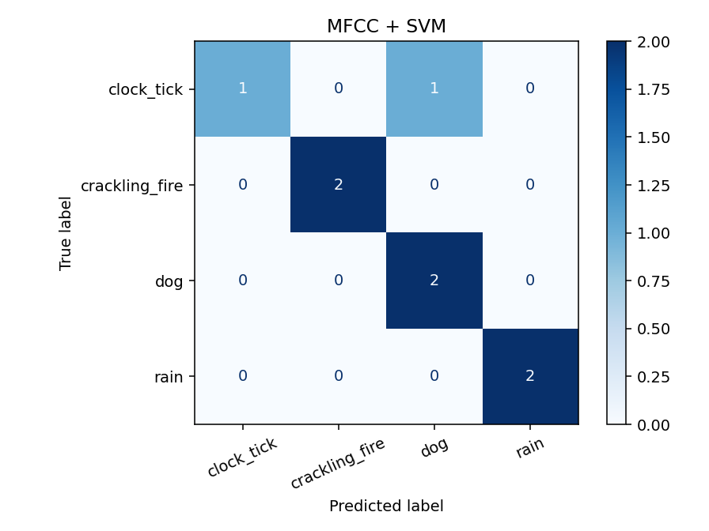
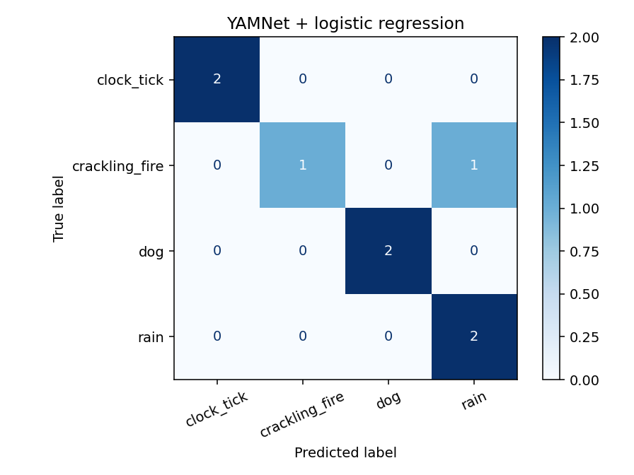

# Audio Processing and AI – Option A

## 1. Project Overview

This project compares two methods for environmental sound classification as part of the Audio Processing and AI course at Savonia University of Applied Sciences.

The selected assignment is **Option A – Compare Sound Classifiers**.

## 2. Dataset

The experiment uses the dataset provided by the course teacher. It includes four sound categories:

- Dog
- Rain
- Crackling fire
- Clock ticking

The original training, validation and test splits were preserved.

## 3. Classification Methods

**Method 1: MFCC + SVM**

MFCC features were extracted from audio recordings and used to train a Support Vector Machine classifier.

**Method 2: YAMNet + Logistic Regression**

Precomputed YAMNet embeddings were used as audio features to train a logistic regression classifier. YAMNet itself was not retrained.

## 4. Experimental Settings

- Audio sampling rate: 16,000 Hz
- Random seed: 42
- MFCC coefficients: 20
- SVM kernel: RBF
- Logistic regression: trained on YAMNet embeddings
- Evaluation: accuracy, macro-F1 and confusion matrices
- Train/validation/test splits: unchanged from the supplied dataset

## 5. Results

| Metric | MFCC + SVM | YAMNet + Logistic Regression |
|---|---|---|
| Test accuracy | 87.5% | 87.5% |
| Macro-F1 | 0.8667 | 0.8667 |
| Correct predictions | 7/8 | 7/8 |

## Confusion Matrices

The following figures show the classification results
for both models on the test dataset.

### MFCC + SVM

### YAMNet + Logistic Regression

## Results Discussion

Both classifiers achieved 87.5% accuracy and a
macro-F1 score of 0.8667.

Each classifier correctly predicted 7 out of 8 test
recordings. However, they made different errors.

MFCC + SVM misclassified a clock-tick recording
as a dog sound.

YAMNet + Logistic Regression misclassified a
crackling-fire recording as rain.

After listening to the crackling-fire recording,
I noticed that it sounded like a mixture of
fire crackling and rainfall. This may explain
why YAMNet confused these two categories.

Both classifiers achieved the same overall performance, but they made different classification errors.

## 6. Misclassification Analysis

I listened to the recording `5-186924-A-12.wav`, which was labelled as crackling fire but predicted as rain by the YAMNet-based classifier.

The recording sounded like a mixture of fire crackling and rainfall. Similar noise-like characteristics may have contributed to the incorrect prediction.

## 7. Limitations and Future Improvements

The test set contained only eight recordings. Therefore, the results are not sufficient to determine which classifier would perform better on a larger dataset.

A future experiment could use more labelled recordings and compare the models using additional training and validation data without using the current test set for tuning.

## 8. How to Run

1. Open `analysis.ipynb` in Google Colab.
2. Select a compatible Python runtime (3.10–3.12).
3. Run the notebook's dependency installation cell and restart the runtime if requested.
4. Upload the original course dataset ZIP when prompted.
5. Run the classifier training and evaluation cells in order.
6. Check the generated results and confusion matrices.

The original course dataset is distributed through Moodle and is not included in this repository.

## 9. Repository Contents

- `analysis.ipynb` – Executed Google Colab notebook
- `README.md` – Project documentation
- `results/classifier_comparison.csv` – Classification metrics
- `results/figures/09_mfcc_confusion.png` – MFCC confusion matrix
- `results/figures/09_yamnet_confusion.png` – YAMNet confusion matrix

## 10. AI Assistance

ChatGPT was used to help interpret the experimental results, troubleshoot Google Colab compatibility issues and prepare the written documentation. The classification experiments were performed using the supplied course notebook.
