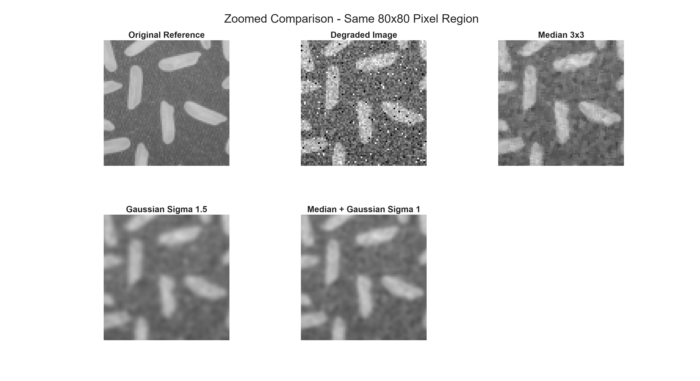

# Image Processing Fundamentals – Individual Assignment

**Course:** Digital Signal Processing (DSP)  
**University:** Savonia University of Applied Sciences  
**Lecture:** 8 – Image as a Signal  
**Selected Option:** A – Compare Denoising Filters  
**MATLAB Version:** R2026b Update 2 (26.2.0.3468271)

## 1. Objective

The objective of this experiment is to compare three image denoising methods and evaluate their ability to remove Gaussian and salt-and-pepper noise.

The comparison uses PSNR, SSIM, and visual inspection to determine which method provides the best balance between noise reduction and preservation of image details.

## 2. Image and Experiment Settings

The experiment uses `rice.png`, a grayscale sample image provided with MATLAB's Image Processing Toolbox.

The image was degraded using the following settings:

- Random seed: `rng(42)`
- Gaussian noise: mean 0, variance 0.01
- Salt-and-pepper noise: density 0.02

Three denoising methods were applied to the same degraded image:

1. **Median filter:** 3 × 3 neighborhood.
2. **Gaussian filter:** sigma = 1.5.
3. **Combined filter:** 3 × 3 median filter followed by Gaussian filtering with sigma = 1.

All settings were kept unchanged as required by the assignment.

## 3. Results

The filtered images were compared against the original reference image.

| Method | PSNR (dB) | SSIM |
|---|---:|---:|
| Degraded image | 18.088 | 0.36958 |
| Median 3 × 3 | 25.370 | 0.62323 |
| Gaussian σ = 1.5 | 25.755 | 0.69213 |
| Median + Gaussian σ = 1 | **26.368** | **0.70515** |

All three filtering methods improved PSNR and SSIM compared with the degraded image.

The combined median and Gaussian filter achieved the highest values for both measurements.

An 80 × 80-pixel region was also selected for visual comparison.

### Visual Comparison

The following figure shows the same 80 × 80-pixel region
from the original, degraded, and three filtered images.

The combined median and Gaussian filter achieved the
highest PSNR and SSIM values. The zoomed comparison
also helps evaluate remaining noise and image blur.

## 4. Main Conclusion

The combined median and Gaussian filter performed best among the three tested configurations, achieving a PSNR of 26.368 dB and an SSIM of 0.70515.

The median filter helps remove isolated salt-and-pepper noise, while the Gaussian filter reduces remaining intensity variations.

Combining these operations produced the closest reconstruction to the reference image according to the two numerical measurements.

However, smoothing may also reduce the sharpness of fine image details.

## 5. Limitations

This experiment uses only one reference image and one fixed noise realization. Different images or noise patterns may produce different results.

PSNR and SSIM do not fully represent perceived image quality, particularly when important fine details are blurred.

Additionally, the filter parameters were fixed, so the experiment compares only the specified configurations rather than identifying the optimal denoising method for every image.

## 6. Files and Results

The repository contains:

- `analysis.mlx` – MATLAB Live Script with the code, figures, numerical results, and explanations.
- `analysis.pdf` – PDF export of the executed Live Script.
- `results/median.png` – Median-filtered image.
- `results/gaussian.png` – Gaussian-filtered image.
- `results/combined.png` – Image processed using the combined filter.
- `results/zoomed_comparison.png` – Visual comparison of the same 80 × 80-pixel region.
- `results/comparison_table.csv` – PSNR and SSIM measurements.

The original MATLAB sample image `rice.png` is not included in the repository.

## 7. How to Run the Experiment

1. Open MATLAB R2026b or a compatible version with the Image Processing Toolbox installed.
2. Download or clone the repository.
3. Open `analysis.mlx` in MATLAB Live Editor.
4. Set the MATLAB Current Folder to the directory containing `analysis.mlx`.
5. Click **Run All** to execute the experiment.
6. Review the generated images, PSNR and SSIM measurements, and visual comparisons.
7. The script saves the processed images and comparison results in the `results/` folder.

## 8. Use of AI Assistance

ChatGPT was used to support the organization of the MATLAB Live Script, explain image processing concepts, and assist with code development and documentation.

The MATLAB experiment was executed by the student, and the numerical results were obtained from MATLAB. The final interpretation was based on the experiment's results.

## 9. References

- Savonia University of Applied Sciences 
- MATLAB Image Processing Toolbox documentation.
