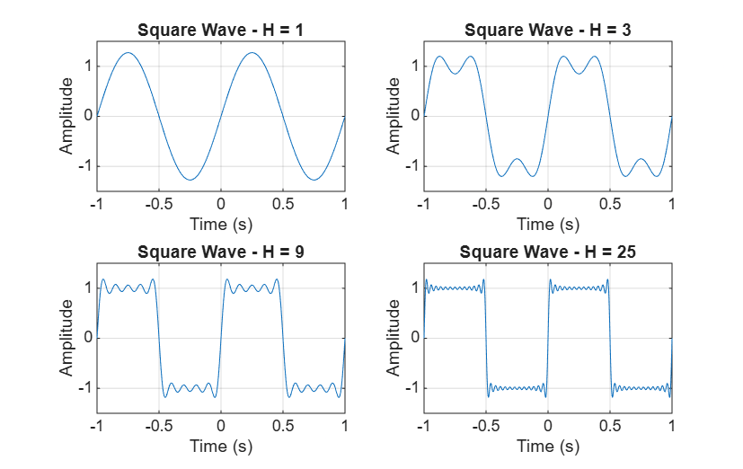
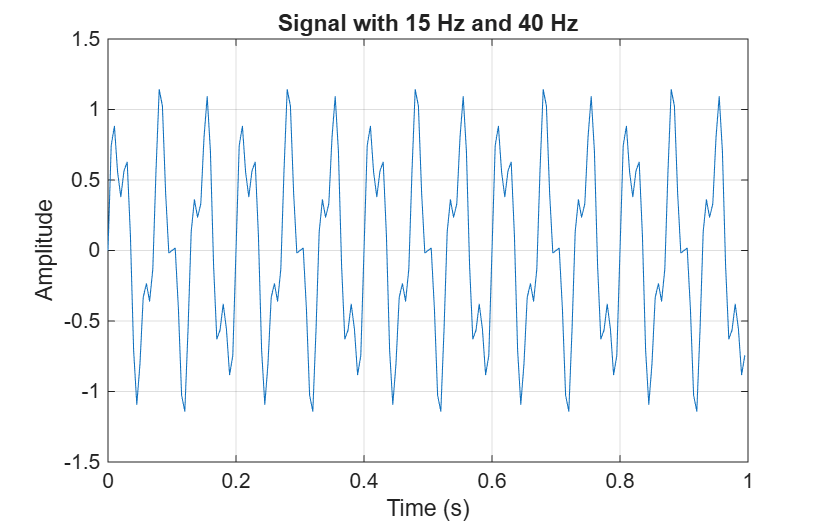
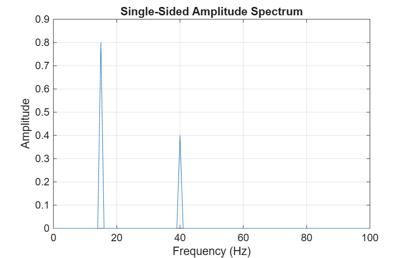
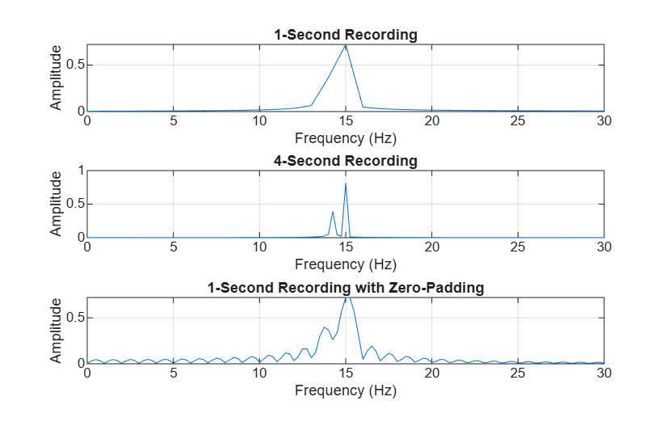
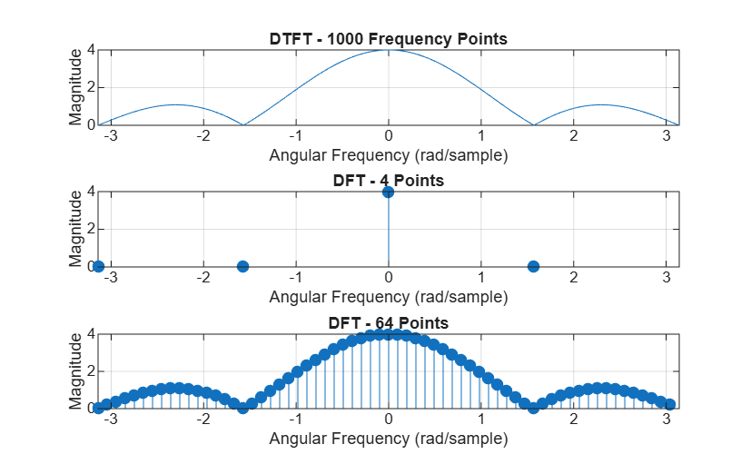

# Lecture 5 – Fourier Series, DTFT and DFT

This assignment investigates Fourier Series, the Fast Fourier Transform (FFT), spectral leakage, and the relationship between the DTFT and DFT using MATLAB Online.

## Exercise 1 – Build a Square Wave from Harmonics

### Prediction

Before running MATLAB, I predicted that adding more odd harmonics would make the waveform closer to a square wave, with flatter sections and sharper transitions.

### MATLAB experiment

I tested four highest harmonic values: H = 1, 3, 9 and 25.

### Observations

- H = 1: The waveform looks like a sine wave.
- H = 3: The waveform begins to resemble a square wave.
- H = 9: The flat sections and sharp transitions become clearer.
- H = 25: The approximation becomes closer to a square wave.

Near the sharp transitions, small oscillations and overshoots appear. This is called the **Gibbs phenomenon**. As more harmonics are added, these oscillations become narrower, but the overshoot does not completely disappear.

## Exercise 2 – Find Two Frequencies with the FFT

### Prediction

I expected the FFT to show two frequency peaks:

| Frequency | Expected amplitude |
|---|---|
| 15 Hz | 0.8 |
| 40 Hz | 0.4 |

### Time-domain signal

I created a signal by adding two sine waves with frequencies of 15 Hz and 40 Hz.

### FFT spectrum

I used MATLAB's `fft()` function to calculate the single-sided amplitude spectrum.

### Comparison

The expected results are peaks at 15 Hz with amplitude approximately 0.8 and at 40 Hz with amplitude approximately 0.4.

These frequencies match the DFT frequency grid, so the peaks should appear at the expected bins.

### Frequency-bin spacing

The sampling frequency is 200 Hz, and the number of samples is 200.

Frequency-bin spacing:

**Δf = fs / N = 200 / 200 = 1 Hz**

Therefore, the frequency-bin spacing is 1 Hz.

## Exercise 3 – Investigate Spectral Leakage

### Student-specific frequency

The second frequency is calculated using:

**f2 = 13.2 + 0.17 × d**

- Last digit used: **6**
- Calculated frequency: **14.22 Hz**

### Prediction

I predicted that the second frequency would cause spectral leakage because it does not generally match an FFT frequency bin.

Its energy would spread across neighboring bins instead of appearing as one sharp peak.

### MATLAB experiment

I compared a one-second recording, a four-second recording, and a zero-padded FFT of the one-second recording.

### One-second recording

- Sampling frequency: 200 Hz
- Number of samples: 200
- Frequency-bin spacing: 200 / 200 = **1 Hz**

### Four-second recording

- Sampling frequency: 200 Hz
- Number of samples: 800
- Frequency-bin spacing: 200 / 800 = **0.25 Hz**

The longer recording has smaller frequency-bin spacing and better frequency resolution. Its spectral peaks are generally narrower, making nearby frequencies easier to distinguish.

### Zero-padding

I used `fft(x, 4*length(x))` to calculate an 800-point FFT from the original 200 samples.

The zero-padded FFT has frequency-point spacing of 0.25 Hz, making the spectrum look smoother.

However, zero-padding does not add new measured samples, remove spectral leakage, or improve the true frequency resolution of the original one-second recording.

## Exercise 4 – Compare the DTFT and DFT

### MATLAB experiment

I used the sequence:

`x = [1 1 1 1]`

I calculated its DTFT at 1000 angular frequency values and compared it with `fft(x,4)` and `fft(x,64)`.

### DTFT and DFT comparison

The DTFT gives a smooth magnitude curve because it can be evaluated at any angular frequency.

The 4-point DFT gives only four frequency samples, while the 64-point DFT gives 64 frequency samples.

The DFT values correspond to samples of the DTFT at discrete frequency positions.

### Why does fft(x,64) produce more points?

The command `fft(x,64)` adds 60 zeros to the original four-sample sequence before calculating the FFT.

This produces more frequency points but does not add new measured signal samples or new information.

### DTFT zeros

The DTFT magnitude becomes zero at:

- ω = −π
- ω = −π/2
- ω = π/2
- ω = π

The maximum magnitude is 4 at ω = 0.

## Software Used

- MATLAB Online
- GitHub

## AI-Use Note

I used ChatGPT to help understand MATLAB syntax, organize the code, and explain Fourier Series, FFT, spectral leakage, DTFT and DFT concepts. I ran the MATLAB scripts myself and checked the resulting graphs. I reviewed the explanations against my results before submitting.
